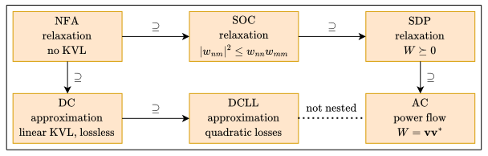
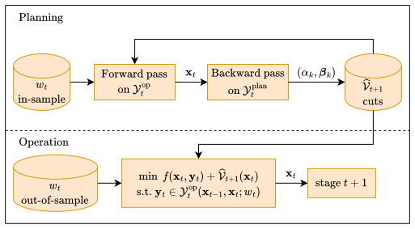
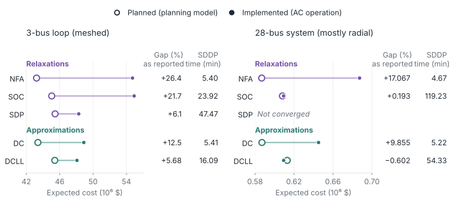

# Design

```@raw html
<p class="eyebrow">The network formulation is an argument, twice</p>
```

## Any network formulation in one multistage model

The package builds an [SDDP.jl](https://github.com/odow/SDDP.jl) policy graph whose stage problems are instantiated by PowerModels.jl inside each subproblem, with the network formulation and the problem builder passed as arguments (`model_constructor_grid`, `post_method`). The hydro layer is written once on top of whatever network PowerModels returns: reservoir volumes with bounds and violation penalties, turbined outflow and spillage along cascades, sampled inflows, hydro generation tied to the network's generator variables, and load shedding at a deficit cost. The formulations are those of PowerModels.jl, from polar AC power flow and its semidefinite, second-order-cone and quadratic-convex relaxations to the DC approximation, with or without losses, and the network-flow model.

A study of network models then becomes a sweep over one argument: the data, the inflow scenarios, the hydro constraints and the SDDP configuration stay fixed while only the network changes. The policy graph and the network builder are themselves arguments of [`hydro_thermal_operation`](@ref) (`build_graph`, `build_opf_model`), so discounting, cyclic graphs or a custom grid model enter the same way.

```@raw html
<figure class="fig inset">
  <picture>
    <source media="(max-width: 640px)" srcset="assets/diagrams/network-simplifications--model-relations-compact.svg">
    
  </picture>
  <figcaption><b>Relaxations contain every AC operating point; the DC approximations are not nested with it.</b> Boxes are feasible sets; an arrow from one set to another means that the first contains the second. Inclusions are in the space of dispatch and storage decisions, as classified in Rosemberg et al. (2022), Sections III and IV-A.</figcaption>
</figure>
```

In PowerModels.jl names, the boxes are `NFAPowerModel`, `SOCWRPowerModel`, `SDPWRMPowerModel`, `DCPPowerModel`, `DCPLLPowerModel` and `ACPPowerModel`; ``W`` is the matrix of voltage products ``\mathbf v \mathbf v^*`` and KVL is Kirchhoff's voltage law. A relaxation solved to optimality bounds the AC cost from below, and its cuts are valid outer approximations of the AC cost-to-go; an approximation has neither property in general. Both statements concern the values computed during planning, not the policy those values induce when the system is operated.

## Cuts on one formulation, operation on another

The planning and operating formulations, and their solvers, are separate parameters of [`create_param`](@ref): `model_constructor_grid_backward` and `model_constructor_grid_forward`, `optimizer_backward` and `optimizer_forward`. When they differ, the package builds two policy graphs over the same data. Training runs SDDP with the backward pass on the planning graph, where the cuts are computed, and the forward pass on the operating graph, where the visited states are generated; after each iteration the cuts are copied to the operating graph. Simulation operates the operating graph with those cuts. Each operated stage solves

```math
\begin{aligned}
\min_{\mathbf x_t,\mathbf y_t}\quad & f(\mathbf x_t,\mathbf y_t)+\widehat{\mathcal V}_{t+1}(\mathbf x_t)\\
\text{s.t.}\quad & \mathbf y_t\in\mathcal Y_t^{\mathrm{op}}(\mathbf x_{t-1},\mathbf x_t;w_t),
\end{aligned}
```

with the cuts of ``\widehat{\mathcal V}_{t+1}`` computed on ``\mathcal Y^{\mathrm{plan}}`` at the states that operation visits.

```@raw html
<figure class="fig">
  <picture>
    <source media="(max-width: 640px)" srcset="assets/diagrams/network-simplifications--plan-realize-compact.svg">
    
  </picture>
  <figcaption><b>Only the cuts cross from planning to operation.</b> Backward passes compute cuts on the planning model at the states that forward passes reach under the operating model; operation then solves every stage under the operating model with those cuts, on scenarios not used in planning. Method of Rosemberg et al. (2022), Fig. 1, extending Brigatto et al. (2017).</figcaption>
</figure>
```

In the package's terms, ``\mathcal Y_t^{\mathrm{plan}}`` is the stage built with `model_constructor_grid_backward` and ``\mathcal Y_t^{\mathrm{op}}`` the stage built with `model_constructor_grid_forward`; both default to `model_constructor_grid`. The state ``\mathbf x_t`` holds the reservoir volumes, ``\mathbf y_t`` the network and hydro decisions of the stage (generation, flows, outflow, spillage, deficit), ``w_t`` the sampled inflows and ``f`` the stage cost. ``\widehat{\mathcal V}_{t+1}`` is the maximum of the cuts ``\alpha_k + \boldsymbol\beta_k^\top \mathbf x_t``, each given by its intercept and slope ``(\alpha_k, \boldsymbol\beta_k)``.

The quality of a simplified planning model is the cost it induces on the system that is operated. Measuring that cost requires exactly this pairing, and making it a parameter turns the assessment of any planning model against any operating model into one run.

## Example: plan on DC power flow, operate under AC

The example follows [`examples/HydroValleys/case3_inconsistency.jl`](https://github.com/LAMPSPUC/HydroPowerModels.jl/blob/main/examples/HydroValleys/case3_inconsistency.jl): cuts are computed on the DC approximation with a linear solver, while forward passes and the final simulation run the polar AC model with a nonlinear solver.

```julia
using HydroPowerModels, HiGHS, Ipopt

# a case folder: PowerModels.json, hydro.json, inflows.csv
data = HydroPowerModels.parse_folder("testcases/case3")

params = create_param(;
    stages = 12,
    model_constructor_grid = DCPPowerModel,           # planning: computes the cuts
    model_constructor_grid_forward = ACPPowerModel,   # operation: visits states, realizes costs
    post_method = PowerModels.build_opf,
    optimizer = HiGHS.Optimizer,
    optimizer_forward = optimizer_with_attributes(Ipopt.Optimizer, "tol" => 1e-6),
    stage_hours = 24 * 30,
)

m = hydro_thermal_operation(data, params)
HydroPowerModels.train(m; iteration_limit = 100)
results = HydroPowerModels.simulate(m, 100)              # 100 scenarios operated under AC

results[:simulations][1][1][:objective]                  # stage-1 cost of the first scenario
```

Dropping the forward arguments plans and operates on the same model. Changing `model_constructor_grid` to another formulation, such as `SOCWRPowerModel` with a conic solver, while keeping the AC forward model, gives the next point of the comparison.

## Published comparison

The assessment of planning network models under AC operation in Rosemberg et al. (2022) is this sweep: the planning formulation changes, and the operating formulation stays at AC power flow.

```@raw html
<figure class="fig">
  <picture>
    <source media="(max-width: 640px)" srcset="assets/network-simplifications-policies-tall.svg">
    
  </picture>
  <figcaption><b>Planned costs follow the inclusion order; implemented costs do not.</b> Open markers show expected cost under the planning model; filled markers show expected cost when the same cuts are operated under AC power flow on 3,000 out-of-sample scenarios. Columns give the inconsistency gap and the SDDP time in minutes. Data: Rosemberg et al. (2022), Tables I and II.</figcaption>
</figure>
```

## Results in PowerModels' terms

Inputs are a PowerModels network file and a reservoir file, validated against JSON schemas (see [Case data](inputfiles.md)). Each simulated stage returns the PowerModels solution, with generation, flows, voltages and dual variables, together with the reservoir trajectories, so prices and flows are compared across formulations directly (see the [Manual](getstarted.md)). A statistical stopping rule, `SimulationStalling`, ends training when a t-test cannot distinguish the simulated costs of successive policies.

## References

- Rosemberg, A. W., Street, A., Dias Garcia, J., Valladão, D. M., Silva, T., Dowson, O. (2022). Assessing the cost of network simplifications in long-term hydrothermal dispatch planning models. *IEEE Transactions on Sustainable Energy*, 13(1), 196–206. [doi:10.1109/TSTE.2021.3106810](https://doi.org/10.1109/TSTE.2021.3106810)
- Brigatto, A., Street, A., Valladão, D. M. (2017). Assessing the cost of time-inconsistent operation policies in hydrothermal power systems. *IEEE Transactions on Power Systems*, 32(6), 4541–4550. [doi:10.1109/TPWRS.2017.2672204](https://doi.org/10.1109/TPWRS.2017.2672204)
